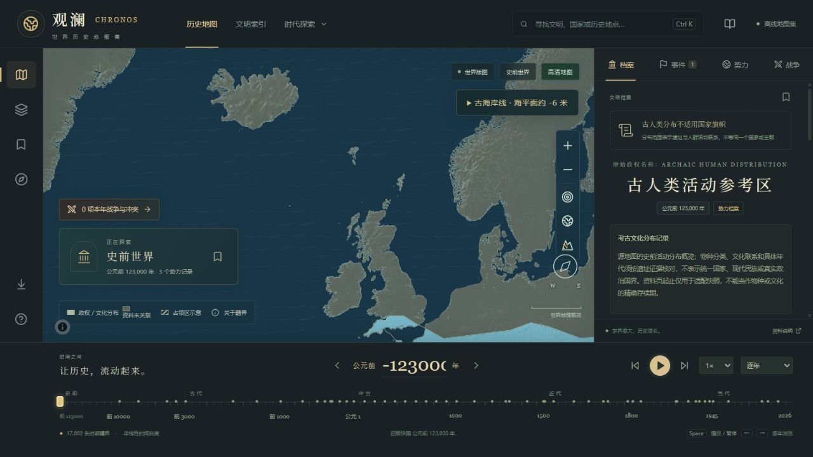

# 史前岛屿与墨西哥缩放缺口修复

问题：缩小地图时，不列颠、冰岛、印度尼西亚、菲律宾、澳大利亚、新西兰、加勒比部分岛屿只剩海岸线；墨西哥出现横向海洋色缺口。放大后恢复。

原因已用项目实际使用的 `@maplibre/geojson-vt`、`classifyRings` 和 Earcut 重现。原始陆地及海洋几何有效，但海洋遮罩包含大量陆地内环。低倍率矢量瓦片的整数化会使微小内环翻转方向；后续陆地内环被错误分组，海洋填充及三角剖分因此跨过岛屿或陆地。只把MultiPolygon拆成Polygon不足以解决这次问题。

修复将海洋绘制几何沿共享经线、纬线切成独立、无内环的Polygon。原始海洋遮罩保留，历史领土数据和海岸线依据未改写；面积差控制在浮点误差范围。现代遮罩及16个古海平面切片全部生成对应绘制资源。水波纹使用同一绘制资源，关闭内部拼接边缘的抗锯齿；海岸线仍由陆地边缘绘制。

涉及文件：

- `scripts/prepare_ocean_render_mesh.py`：可复现分片与面积检查。
- `scripts/prepare_paleogeography.py`：古地理数据生成后自动更新海洋绘制资源。
- `src/MapView.tsx`：初始加载、切换年份及恢复现代海岸线均使用新的遮罩。
- `src/ocean.ts`：绘制片拼接处的水波纹处理。
- `public/data/ocean-render-review.json`：17份遮罩的生成与检查记录。
- `tests/paleo-render.test.mjs`：实际瓦片整数化、环分类及三角剖分回归测试。

验证覆盖多个史前海平面分期及现代底图，在0—6级缩放下检查不列颠、冰岛、印尼、菲律宾、澳大利亚、塔斯马尼亚、新西兰南北岛、古巴、牙买加、波多黎各，以及墨西哥内陆网格；另检查深海保持海洋填充。浏览器实测不列颠和冰岛已经恢复填充，缩放后保持显示。

123项测试通过，生产构建通过，17份绘制遮罩与发布目录内容一致。

重建：`python -X utf8 scripts/prepare_ocean_render_mesh.py`，然后 `npm run build`。应用中按Ctrl＋F5加载新版。
